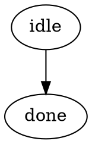

# specdot language reference

This document defines the source language accepted by `specdot vet` v1. The
language has three layers:

1. DOT declares topology, named behavior, and cross-file interfaces.
2. Linked Markdown explains intent and contains typed `specdot` YAML contracts.
3. `specdot.yaml` defines the module boundary and validation profiles.

The compiler lowers all three into canonical `specdot.ir/v1`. Rendering
attributes such as `label`, `shape`, and `color` never carry normative meaning.

## Module manifest

Every module has a `specdot.yaml`:

```yaml
schema: specdot/v1
module: example.com/acme/controller
roots: [specs]
include: ["**/*.dot", "**/*.md"]
exclude: ["archive/**"]
link_policy:
  require_backlinks: true
  allow_remote: false
  remote_timeout: 5s
profiles:
  default:
    finite:
      enabled: true
      max_states: 10000
      max_depth: 200
      max_queue: 8
      max_transitions: 100000
  build:
    build_ready: true
    warnings_as_errors: true
    finite:
      enabled: true
      required: true
      max_states: 100000
      max_depth: 1000
      max_queue: 16
      max_transitions: 1000000
```

Rule severities can be overridden by stable rule ID with `rules: {SDV119:
off}`. Syntax, identity, and safety-critical rules remain non-waivable even when
a source waiver is present.

## Semantic IDs and status

Every graph, node, and edge has a module-wide semantic ID. Prefer
`specdot_id`; `id` is accepted for compatibility. DOT identifiers are only
local parser handles and are never used to link specifications.



IDs may contain letters, digits, `.`, `:`, `/`, `_`, and `-`, and must begin
with a letter. IDs differing only by case are rejected. Repeating a DOT node
declaration is rejected even when its semantic IDs differ. Chained edges must be
split so every segment has its own edge ID.

`specdot_status` is one of `active` (default), `draft`, `historical`, or
`superseded`. An active declaration cannot depend on a historical or superseded
declaration.

## Graph kinds

Each graph declares `specdot_version="1"` and one `specdot_kind`:

- `promise` describes agents, promises, signals, impositions, and assessments.
- `machine` describes a hierarchical extended finite state machine.
- `algorithm` describes executable control/data flow.
- `data` describes nominal data and resource types and their relationships.
- `scenario` describes an end-to-end witness, fault, or recovery path.
- `decision` records non-executable architecture and ownership decisions.

`promise`, `machine`, `algorithm`, and `scenario` graphs must be directed.
Nodes referenced by an edge must be explicitly declared; DOT's implicit-node
feature is too easy to mistake for a complete interface.

### Algorithm and scenario completeness

An algorithm/scenario needs an initial or input node and a final or output node.
Every active node must be reachable from an entry and able to reach an exit.
Non-final nodes need outgoing flow. A `decision` node needs at least two edges,
each with a distinct `specdot_branch`.

Module boundary nodes use:

```dot
request [specdot_id="algorithm.request", specdot_role="input",
         specdot_type="type.request",
         specdot_accounted_by="promise.request.offer"];
```

`specdot_accounted_by` must name an interface-bearing declaration in a
different DOT file. This makes every input and output somebody else's explicit
promise, channel, or data contract.

## Markdown and contracts

Any graph, node, or edge may have a `URL`. Repository-local Markdown is the
default and is resolved relative to the DOT file:

```dot
graph [URL="worker.md#worker-machine"];
```

The file and heading anchor must exist. With `require_backlinks`, the Markdown
must link back to the owning DOT file. Remote HTTP(S) Markdown must be enabled
by policy and is only probed when `--online` is passed; a build profile treats
an unprobed remote contract as inconclusive.

Normative detail lives in fenced YAML blocks:

````markdown
```specdot
schema: specdot.contract/v1
for: machine.worker
kind: machine
summary: One worker lifecycle.
machine:
  agent: agent.worker
  semantics: run-to-completion
  events:
    - name: Start
      policy: handled
```
````

`for` extends an existing DOT semantic ID; it never defines a second copy. Only
one block may extend an ID. Contracts reject unknown fields, duplicate keys,
aliases, merge keys, custom tags, and multi-document YAML so review and hashing
cannot be changed by hidden YAML machinery.

## Promise Theory IR

Promise declarations make autonomy visible. An offer (`+`) by agent A to agent
B does not cause B to act. A compatible acceptance (`-`) is a separate promise
made by B to A. `vet` derives a binding only when the parties reverse, nominal
body types and resources match, and constraints are compatible.

```dot
a -> b [specdot_id="promise.request.offer", specdot_kind="promise",
        specdot_polarity="offer", specdot_type="type.request"];
b -> a [specdot_id="promise.request.accept", specdot_kind="promise",
        specdot_polarity="accept", specdot_type="type.request"];
```

A promise contract can add `scope`, a typed `body`, `prerequisite`, CEL
`condition`, observer-local `evidence`, and `external`. Prerequisite cycles are
errors. External promises are explicit environment assumptions; they are not
silently invented to close the graph.

Agent contracts name locally controlled resources, capabilities, machines, and
superagent members. `signal` and `imposition` edges describe attempted
information or influence and may not carry promise polarity. `assessment`
contracts name the observer, subject, predicate, and evidence. An observation,
copy, or signature may support an assessment but never becomes authority merely
because an observer trusts it.

## Data models

Data contracts are nominal. Equal encodings do not make two types
interchangeable. Supported kinds are `scalar`, `enum`, `record`, `union`,
`optional`, `list`, `set`, `map`, `ref`, `newtype`, and `resource`.

```yaml
schema: specdot.contract/v1
for: resource.car
kind: resource
data:
  type: resource
  fields:
    - {name: logical_id, type: type.car.logical}
    - {name: file_id, type: type.car.file_id}
  identity: [logical_id]
  authority: agent.planner
  mutable: true
  exclusive: true
  lifecycle: [planned, installed, accepted, failed]
  retention: [failure, unknown]
  physical_id_type: type.car.file_id
  encoding: json
  version: v1
  migration: explicit-copy
```

Field names and type references must resolve. Mutable data needs identity.
Exclusive resources need a controlling agent. Logical and physical identities
must be distinct nominal types. Two active resources cannot claim one logical
identity unless an explicit replica relationship is declared.

Data-graph edges have `specdot_kind="relationship"`, a `specdot_relation` of
`contains`, `references`, `owns`, `derives`, `maps_to`, `variant_of`, or
`replica_of`, and target `specdot_cardinality` of `1`, `0..1`, `1..*`, or
`0..*`. Containment/ownership is acyclic and exclusive unless shared ownership
is explicit. Recursive references must say `specdot_recursive=true`.

## Channels and effects

A channel contract fixes endpoints, payload, delivery, ordering, duplicate and
loss behavior, capacity, durability, integrity, timing, partition behavior, and
restart behavior. The build profile rejects any omitted channel dimension.

An effect names the agent controlling the local capability, operation,
resource, and `success`, `failure`, and `unknown` outcomes. Destructive effects
also need retention/deletion, idempotency, correlation, retry, reconciliation,
evidence, and assessor contracts.

```yaml
effect:
  agent: agent.planner
  operation: replace
  resource: resource.car_file
  outcomes: [success, failure, unknown]
  retain_on: [failure, unknown]
  delete_on: [success]
  idempotency: content-addressed
  correlation: car_id
  retry: bounded exponential
  reconcile: compare desired and installed digest
  evidence: atomic-rename receipt
  assessor: agent.planner
```

Deleting on an outcome that the resource says to retain is non-waivable. Two
agents publishing one exclusive resource need an explicit deterministic
selection/failover decision.

## Machine semantics

A machine is a hierarchical EFSM. States use `specdot_parent` and
`specdot_region`; each region has exactly one `specdot_initial=true` state.
Multiple regions under one active composite are orthogonal and transition in
one atomic macrostep. `final`, `fork`, `join`, and `history` are explicit
pseudostate kinds.

Transitions use:

- `specdot_event` for an external/internal event;
- `specdot_after` for a duration-triggered timer;
- `specdot_guard` for restricted CEL;
- `specdot_action` for semicolon-separated assignments;
- `specdot_raise` for internal events;
- `specdot_send` and `specdot_receive` to connect agent machines through a
  declared channel;
- `specdot_priority` or `specdot_nondeterministic=true` for conflicts; and
- `specdot_internal=true` to avoid exit/re-entry.

States may define `specdot_entry` and `specdot_exit` assignments. One external
event runs to completion: the deepest enabled transition wins, independent
parallel regions are batched, exits run inner-to-outer, transition actions run,
entries run outer-to-inner, and raised internal/eventless work drains before
another external event is admitted. Every accepted event must be handled,
deferred, refused, or ignored in every active state. Eventless cycles need a
statically visible bound and still cannot exhaust the run-to-completion budget.

History pseudostates are parsed and structurally linted. The v1 finite checker
does not yet lower saved history configurations, so a machine containing one is
reported inconclusive; a profile with `finite.required` rejects it.

Channel send/receive ownership is linked across agent machines. The v1 checker
uses a conservative agent-local abstraction: sends do not block local control,
and declared receives are independently schedulable environment deliveries.
Such a successful run is reported `assumed`, with those assumptions embedded in
the IR, rather than as an unconditional global queue proof.

The source model can therefore describe communicating agents and unbounded
Turing-equivalent implementations without pretending to decide them. Native
verification is deliberately finite: machine variables, queues, depth, and
transition exploration are bounded by the selected profile, and every
abstraction or environment dependency stays visible as `assumed`, `unchecked`,
or `inconclusive`.

### Finite variables and CEL

Machine variables have finite domains:

```yaml
variables:
  - name: retries
    type: int
    initial: 0
    min: 0
    max: 3
  - name: mode
    type: string
    initial: idle
    values: [idle, busy]
```

CEL expressions can read declared variables plus `state`, `event`, and dynamic
`data`, `subject`, and `context` values. There are no host I/O, network,
mutation, wall-clock, random, or recursive callbacks. Actions are assignments,
for example `retries = retries + 1; mode = "busy"`; leaving a declared finite
domain makes verification inconclusive rather than wrapping or inventing a
value.

### Claims and native verification

Supported finite claims are `invariant`, `always`, `never`, `forbidden`,
`reachable`, `deadlock_free`, `transition_coverage`, `eventually`, and
`leads_to`. Safety failures report the shortest deterministic BFS trace.
Liveness uses strongly connected components to find an execution that can
avoid its target forever.

`eventually` and `leads_to` must list explicit `assumptions` describing the
scheduler/environment fairness under which progress is expected. A successful
liveness result is reported as `assumed`, not as an unconditional proof; a
counterexample is still `violated`.

The checker hashes canonical configurations containing active leaves, typed
variables, and the internal event queue. Reaching a state, depth, transition,
or queue bound is `inconclusive`, never `passed`. A required claim or required
finite profile turns that result into a vet error.

## Build-readiness and latitude

The `build_ready` profile requires graph-level Markdown contracts, machine
ownership, scenarios, finite proof where configured, complete channel/effect
semantics, data encoding/migration choices, secret handling, and explicit trust
boundaries. Deliberately open implementation choices use structured latitude:

```yaml
latitude:
  - area: provider-selection
    allowed: [primary-with-cold-standby, deterministic-hash-shard]
    constraint: exactly one writer for each logical resource
    owner: architecture
```

Latitude constrains a generator; it is not a placeholder such as “TBD”.

## Waivers

Waivers are scoped to the contract target and require rule, reason, owner,
expiry, risk, and mitigation:

```yaml
waivers:
  - rule: SDV336
    reason: This service state is intentionally nonterminating.
    owner: runtime-team
    expires: 2027-01-31
    risk: A shutdown path could remain absent.
    mitigation: Deployment drains the process externally.
```

Expired or incomplete waivers are errors. Syntax errors, duplicate identity,
missing targets, promise cycles, and destructive retention contradictions are
non-waivable.

## Canonical IR

`--emit-ir path` writes deterministic JSON with source hashes, graphs,
effective contracts, derived promise bindings, finite-check results, traces,
and a SHA-256 content digest. Ordering is normalized before hashing. This is the
only intended input to future `specdot build`; generators should not reinterpret
DOT or Markdown independently.
